# Ember — Brutal Design & Function Audit

**Product:** Ember · Gurugram Fire Hazard (prototype, simulated data)
**Scope:** Landing page `/`, live dashboard `/live`, both themes, desktop (1440×900) and phone (375×812)
**Date:** 20 Nov 2026 · **Build:** working tree after Phase 2 + incident-mix redesign + history replay
**Verdict at audit time:** **6 / 10.** It looks expensive and works mechanically, but **the data story is broken**: the hazard model barely moves, two KPIs contradict each other, and the light theme fails contrast on its most important number. The interface is ahead of the product it displays.

> ## ✅ Resolution — all 29 findings fixed (re-audited 20 Nov 2026)
> **Verdict after fixes: 8.5 / 10.** Every critical, major and minor finding below has been fixed and re-measured with the same probes and capture pipeline. Before/after numbers and the "after" figures are in [Resolution log](#resolution-log). Remaining caveats are listed honestly at the end of that section.

---

## How to read the figures

Every figure is a real screenshot from headless Chrome with numbered boxes drawn on top:

| Box colour | Meaning |
|---|---|
| 🟥 Red | **Critical**: misleads the user, breaks a core job, or fails a hard accessibility rule |
| 🟧 Orange | **Major**: clearly wrong or degraded; fix before showing to stakeholders |
| 🟨 Yellow | **Minor**: polish, consistency, edge cases |
| 🟩 Green | **Works**: keep it as it is |

The number in each box matches the finding IDs and the figure notes below.

---

## Scorecard

| Area | Score | One-line reason |
|---|---|---|
| Visual design and atmosphere | **8** | Strong, original identity (ember on soot or paper, grain, glass). Reads as designed, not templated. |
| Typography | **7** | Good 3-family system; let down by 104 text nodes at 11 px or smaller on `/live`. |
| Colour: dark theme | **9** | Every token ≥ 3.77:1, body text 16.9:1. |
| Colour: light theme | **4** | Amber and orange hazard colours fail (2.87 and 2.91:1), including the headline score. |
| Theming mechanics | **8** | Light, dark and system all work; the map style swaps; no flash of the wrong theme. |
| Layout and responsive | **5** | No horizontal overflow, but on phones the top bar covers the KPIs and 254 px of KPIs are hidden on desktop. |
| **KPIs and data semantics** | **3** | Contradictory thresholds, dead KPIs, noisy percentages, sparklines that exaggerate small changes. |
| **Hazard model output** | **3** | District always "Moderate"; 0 high-risk zones in every sample across 7 days. |
| Map, density surface and 3D | **6** | The 2D density surface is excellent; 3D zones mode buries it. |
| Accessibility | **5** | Named controls and reduced motion are good; `h1` text, the auto-scrolling ticker, small text and small targets are not. |
| Performance | **6** | 60 fps and a 3 ms KDE are great; 0.9–1.3 s main-thread blocks on `/live` load are not. |
| Functionality | **8** | Replay, palette, density controls, terrain, theme and zone drill-down all work. One crash bug was found and fixed. |
| Honesty and labelling | **9** | Watermark, SIM badge, prototype-index note, real 101/112. |

---

## Critical findings

### C1 · The hazard model is flat: the product's main message never changes
**Evidence.** I scrubbed the replay to 9 points spread across 7 days. The district FHS stayed between **28 and 34** and was **"Moderate" in 9 of 9 samples**. **High-risk zones was 0 in 9 of 9.** The highest zone score was 54, so the "Very High" and "Extreme" bands, and their advice, never appear. The "Peak density" KPI said **"Udyog Vihar" in 9 of 9**.

| Replay offset | District FHS | Zone range | Incidents 24h | Compliance | High-risk | Pop. exposed | Utilization |
|---|---|---|---|---|---|---|---|
| now | 34 | 27–51 | 9 | 33 % | 0 | 455k | 0 % |
| −6 h | 28 | 21–42 | 9 | 22 % | 0 | 8k | 0 % |
| −12 h | 31 | 22–49 | 10 | 30 % | 0 | 218k | 0 % |
| −18 h | 34 | 25–46 | 11 | 30 % | 0 | 590k | 11 % |
| −1 d | 33 | 26–54 | 11 | 55 % | 0 | 440k | 4 % |
| −2 d | 31 | 24–45 | 5 | 80 % | 0 | 440k | 0 % |
| −3.5 d | 30 | 23–45 | 8 | 88 % | 0 | 378k | 0 % |
| −5 d | 33 | 26–48 | 12 | 75 % | 0 | 500k | 0 % |
| −7 d | 31 | 24–45 | 4 | 25 % | 0 | 440k | 0 % |

**Root cause.**
- November climatology gives an FFWI of about 7–13, so the weather component contributes only about 15 of its 40 points.
- Fuel is static per zone.
- Ignition pressure rarely goes above 10 of its 25 points.
- Hazard sample-point weights follow zone FHS, which barely changes, so the same zone always peaks.

**Fix.**
- Score weather against local percentiles, not an absolute FFWI ceiling of 35.
- Add a diurnal fuel or activity term per land use (markets in the evening, industry by day, landfill in the afternoon heat).
- Set a target band distribution (for example 35/30/20/10/5 %) and tune to it with a unit test.
- Add a "summer peak" demo preset so stakeholders can see the upper bands.

See figures 01 (②), 03 (①③), 05 (③).

### C2 · Two KPIs contradict each other: "0 high-risk zones" next to "455k exposed"
**Evidence.**
- "High-risk zones" counts zones at **Very High or above** (band ≥ 3).
- "Population exposed" counts zones at **High or above** (band ≥ 2).
- The two sit side by side, so the screen says nothing is high-risk while 455k people are exposed.
- Exposure jumps 8k → 590k when a single zone crosses a threshold.

**Fix.** Use one threshold, state it in the label ("High+ zones", "Pop. in High+"), and show the count of zones next to the population.

See figure 03 (③④).

### C3 · Light theme: the most important number fails contrast
**Evidence.** In light mode the district score, zone values and "Moderate" text are drawn in `--hz-1` `#b5850c` on cream: **2.87:1**. That fails AA even for large text, which needs 3:1. "High" (`--hz-2`) is **2.91:1**. Low (`--hz-0`) is 3.32:1.

**Fix.**
- Light `--hz-1` → about `#8a6400` and `--hz-2` → about `#b4500a` (both ≥ 4.5:1).
- Or render scores in `--text` with a band-coloured underline or chip, and keep the colour for fills only.

See figures 02 (①), 04 (①②), 06 (①③), 12 (①), 14.

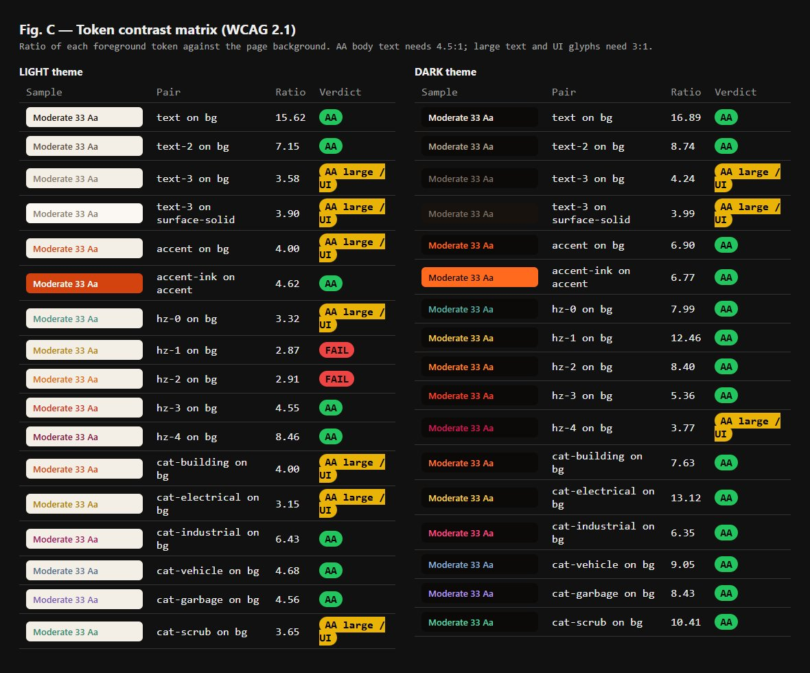
*Fig 14 — Contrast of every colour token against the page background, light vs dark. Red FAIL = below 3:1.*

### C4 · Phone layout: the top bar covers the KPI labels
**Evidence.** At 375 px the top bar wraps to two rows. The second row (the Hazard/Incident toggle) sits on top of the KPI strip and hides every KPI label. The probe also reports 7 of 10 labels truncated and 1131 px of the strip hidden off-screen.

**Fix.** Measure the top bar height with a ResizeObserver and use it as a CSS variable for the KPI strip's `top`. Better: on phones, move the surface toggle into the bottom sheet and show only 3 KPIs.

See figure 11 (①).

### C5 · 3D zones mode hides the data it is meant to show
**Evidence.**
- Extrusion height = FHS × 55 m, so blocks are up to about 2.8 km tall at district scale.
- The blocks are nearly uniform amber (because of C1) and cover the density surface entirely.
- Basemap labels draw on top of the extrusions as ghosted text.
- The 3D toggle is also wired to the "High-risk zones" KPI, which is always 0.

**Fix.**
- Scale height to the min–max range with a lower ceiling (about 600 m) and opacity about 0.35.
- Better: extrude the density grid (hex or cell columns) instead of zone polygons.
- Hide symbol layers while pitched.

See figure 10 (①②③).

---

## Major findings

| ID | Finding | Evidence | Fix |
|---|---|---|---|
| **M1** | **Screen readers hear "Everyember,mapped."** The words are separated by CSS margin only. | DOM text probe, fig 01 ① | Put real spaces inside the spans, or add `aria-label` on the `h1`. |
| **M2** | **The incident ticker scrolls forever.** It pauses only on mouse hover, with no keyboard or touch pause (WCAG 2.2.2). Items are duplicated in the DOM. | fig 05 ④ | Add a pause button, pause on `:focus-within`, and give the duplicate set `aria-hidden`. |
| **M3** | **KPI strip hides 254 px on a 1440 px screen.** The last tile is cut off and there is no scroll cue. | probe `kpiHidden: 254`, fig 05 ① | Add an edge fade plus a chevron, or cut to the 6 KPIs that matter and put the rest in a drawer. |
| **M4** | **KPI labels are truncated.** Four on desktop: "Active incidents", "Response compliance", "Population exposed", "Station utilization". | probe, fig 05 ② | Shorter labels ("Active", "On-time %", "Pop. High+", "Units out"); full name in a tooltip. |
| **M5** | **Text is too small.** `/live` has 104 text nodes at 11 px or smaller (30 at 10 px, 1 at 9 px). Most are uppercase mono with 0.16 em tracking in `--text-3`, which is 3.58:1 (light) or 3.99:1 (dark on surface) and fails 4.5:1. | probe, fig 06 ② | Minimum 12 px for labels; `--text-3` light → about `#6f6155`, dark → about `#9a8c7f`. |
| **M6** | **The light-theme density surface looks muddy.** The low band (teal at 34–42 % alpha over cream) reads as grey-green dirt, not "calm". | fig 06 ④ | In light mode start the ramp at transparent → amber; or use `multiply` blending with a more saturated low band. |
| **M7** | **Map labels bleed through the landing headline and body copy** (light and phone). | figs 02, 12 | Hide symbol layers in the hero map and strengthen the scrim on the text side. |
| **M8** | **Replay cannot reach its top speed.** "2.5h/s" promises 30 ticks/s but delivers **20** (101 ticks in 5.04 s). "1h/s" is accurate (60 ticks in 5.03 s). | timing probe, fig 08 ② | Shift the 24 h history window by one tick instead of recomputing all 288; cache the 24 h-ago count; at speeds of 12 ticks/s or more, run KDE every 2nd tick. |
| **M9** | **The main thread blocks on `/live` load.** Long tasks of **1347 ms** and **880 ms**; LCP was 3.4 s in one run and 1.4 s in another. Landing has a 367 ms long task. | PerformanceObserver | Precompute Voronoi zones and hazard sample points at build time (JSON) and move the simulator into the worker. Turf's intersection and rejection sampling run synchronously at import. |
| **M10** | **Some KPIs are noise or always zero.** Compliance swings from 22 % to 88 % because only 4–12 incidents a day have arrival times, and no sample size is shown. Station utilization was 0 % in 7 of 9 samples. | table in C1 | Show the sample size ("33 % · n=6") or use a 7-day rolling figure; replace utilization with "units available". |
| **M11** | **Sparklines exaggerate small changes.** The y-axis auto-scales to min–max, so a 6-point swing (28→34) fills the full height. There are no axis values. | figs 03 ①, 07 ③ | Fix the domain at 0–100 (or show band stripes) and print the min and max. |
| **M12** | **On phones the map attribution opens over the map** (2 lines of text). | fig 11 ② | Start the compact attribution collapsed. |

---

## Minor findings

| ID | Finding | Where |
|---|---|---|
| m1 | Fire stations use the accent orange, the same hue family as hazard. On light and phone they dominate and read as hazards. Use neutral ink or a blue. | figs 06 ⑤, 11 ③ |
| m2 | The legend title wraps and centres awkwardly ("HAZARD DENSITY · / SIMULATED"). | fig 06 ⑥ |
| m3 | Touch targets are too small: ticker items 20 px tall, footer and nav links 13–20 px (WCAG 2.5.8 needs 24 px). 22 found on `/live`, 13 on landing. | probe |
| m4 | No favicon, so every page load logs a 404. | console |
| m5 | Google Fonts loads Unbounded 400 and 500, which are never used: 2 wasted requests out of 7 font files. | `document.fonts` |
| m6 | The dev URL parameter `?tick=+N` is accepted and shows **future** data under a LIVE badge. The startup offset isn't clamped (the replay setter is). | `store.ts initialOffset` |
| m7 | Replay time drifts: the offset is relative to the clock, so a paused replay jumps 5 minutes at each real tick boundary. | `TimeMachine` |
| m8 | Distance and ETA to the nearest station are straight-line, not by road. The drawer doesn't say so. | fig 07 ② |
| m9 | `/live` has only a screen-reader-only `h1`; the panels have no headings, so screen-reader navigation is flat. | probe `headings: H1` |
| m10 | The "Peak density" tile shows a place name in a tile built for numbers (bold mono, inconsistent). | fig 03 |
| m11 | The landing hero card sits over the hottest part of the hero map. | fig 01 |
| m12 | The wind is one uniform vector plus a decorative wobble. It looks like a model but the UI never says it isn't one (only the README does). | fig 05 |

---

## Fixed during this audit

| ID | What | Status |
|---|---|---|
| F1 | **Crash:** the command palette's global keydown handler threw `e.target.closest is not a function` when the event target wasn't an element (found by the figure 09 capture). | ✅ Fixed: `e.target instanceof Element` guard (`src/components/CommandPalette.tsx`) |
| F2 | **Incident-mix chart** reused the sequential hazard ramp for categorical incident types, with a thin flat ring, no percentages and no interaction. | ✅ Rebuilt: new categorical tokens `--cat-*` (both themes); rounded gapped segments; draw-in animation; hover or focus isolates a segment; % bars (fig 13) |

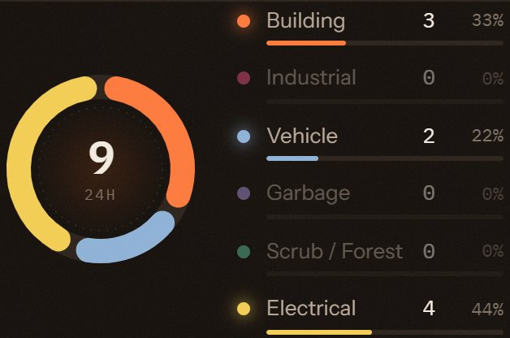
*Fig 13 — The new incident-mix chart: categorical palette (≥ 6.3:1 in dark), gaps between segments, count + share + bar per type, zero-count types dimmed.*

---

## What works (keep it)

- **Identity:** Unbounded + Instrument Sans + IBM Plex Mono all load and give a clear display/body/data hierarchy. The ember-on-soot look is distinctive.
- **Dark theme contrast:** every hazard and category token passes at least AA-large; body text is 16.9:1.
- **Honesty:** the SIM watermark, LIVE/REPLAY badge, prototype-index note and real 101/112 are present on every screen.
- **Accessibility basics:** no unnamed controls in any run; `lang="en"`; focus rings; reduced motion respected; zero horizontal overflow at 375 px.
- **Engineering:** KDE takes **3 ms** in the worker; 60 fps during wind animation (headless); replay is deterministic and accurate at ≤ 12 ticks/s.
- **Transparency:** the zone drawer shows the weather / fuel / ignition breakdown that makes up each score (fig 07 ①).
- **New features:** 7-day replay with scrubber, the Ctrl+K palette and density controls all work as designed (figs 08, 09).

---

## Figures

### Landing

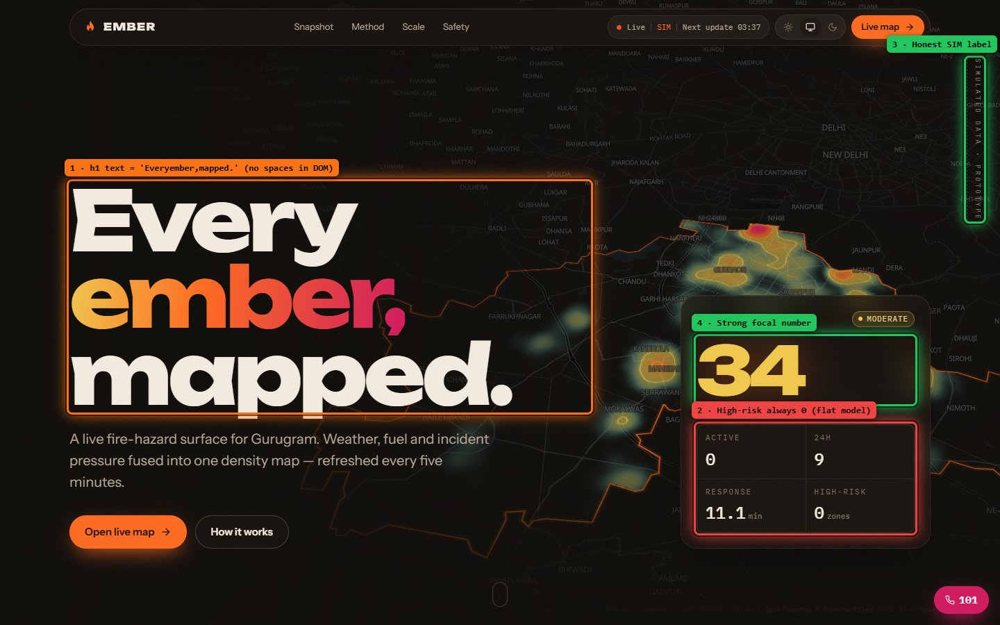
*Fig 01 — Landing hero, dark. ① `h1` accessible text has no spaces (M1). ② "High-risk 0" in every sample (C1). ③ Honest vertical SIM label. ④ Strong focal number.*

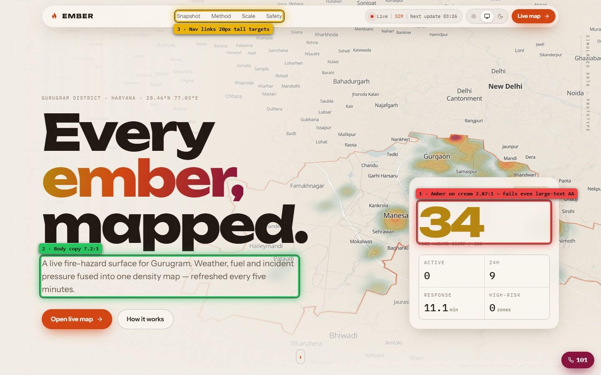
*Fig 02 — Landing hero, light. ① Amber score 2.87:1 (C3). ② Body copy 7.2:1, fine. ③ Nav links are 20 px tall targets (m3). Note the basemap labels behind the copy (M7).*

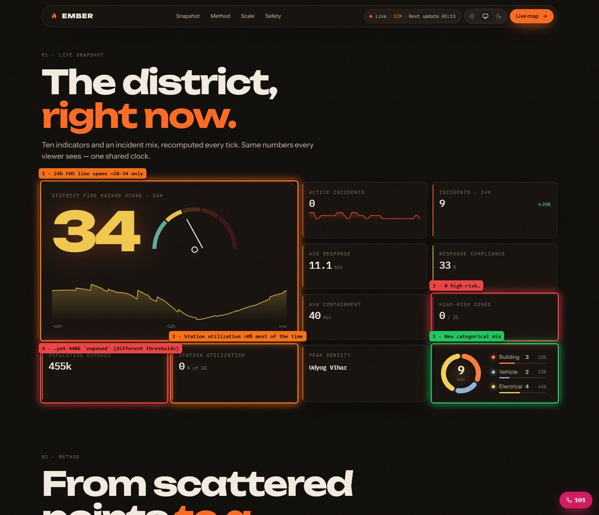
*Fig 03 — Snapshot bento. ① 24 h line spans only about 28–34 but fills full height (C1, M11). ② Station utilization about 0 % (M10). ③④ "0 high-risk" next to "455k exposed" (C2). ⑤ New incident mix.*

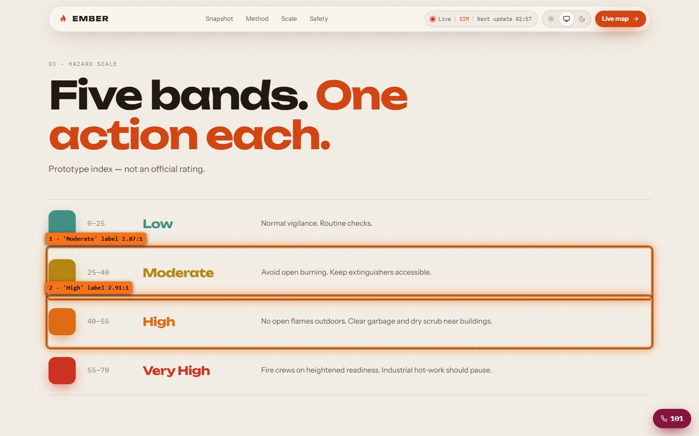
*Fig 04 — Hazard scale, light. ①② "Moderate" 2.87:1 and "High" 2.91:1 fail (C3).*

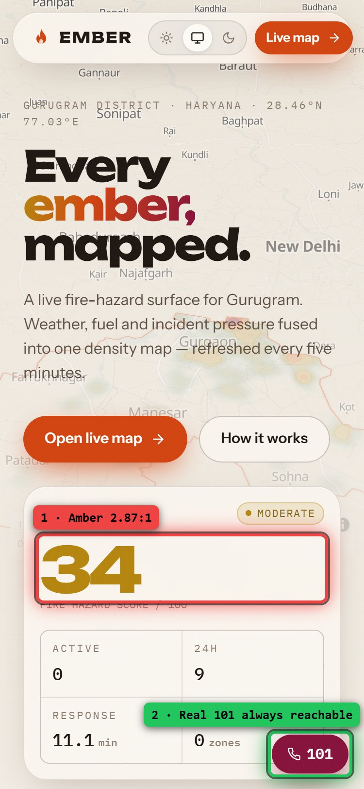
*Fig 12 — Landing on a phone, light. ① Amber score fails contrast (C3). ② The 101 button is always reachable. Basemap labels (Sonipat, Gurgaon, Farrukhnagar) collide with the headline and copy (M7).*

### Live dashboard

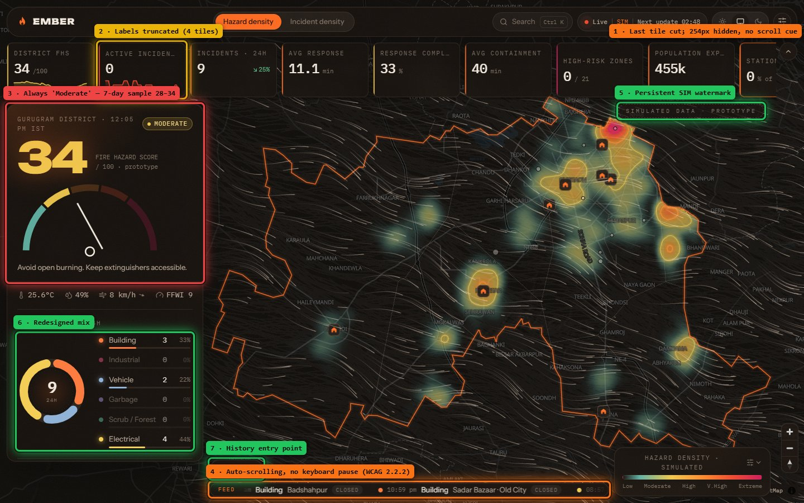
*Fig 05 — `/live`, dark. ① Last KPI tile cut off, 254 px hidden (M3). ② Truncated labels (M4). ③ Always "Moderate" (C1). ④ Auto-scrolling ticker (M2). ⑤ Watermark. ⑥ Redesigned mix. ⑦ History entry point.*

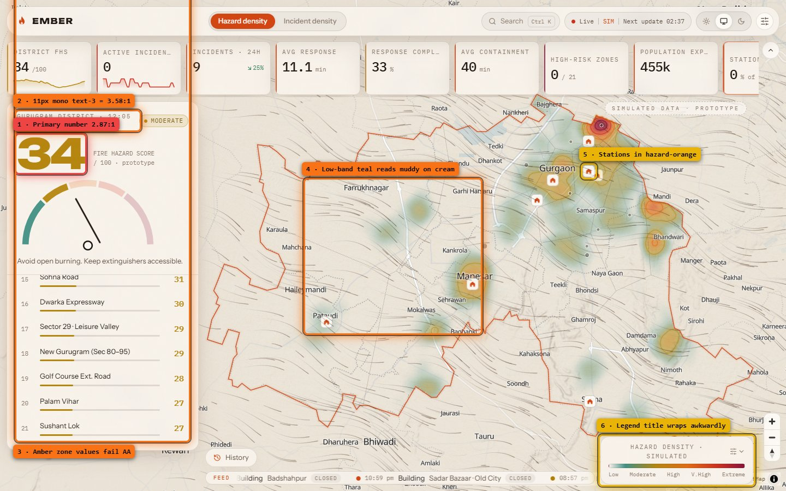
*Fig 06 — `/live`, light. ① Primary score 2.87:1 (C3). ② 11 px mono `--text-3` (M5). ③ Amber zone values (C3). ④ Muddy low-band surface (M6). ⑤ Stations in hazard orange (m1). ⑥ Legend title wrap (m2).*

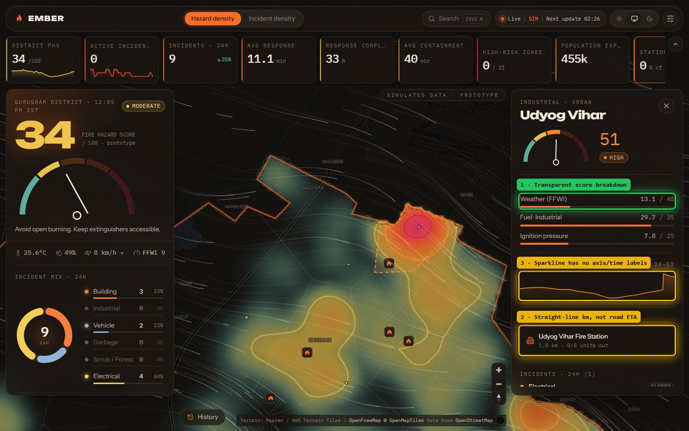
*Fig 07 — Zone drawer. ① Transparent score breakdown. ② Straight-line km (m8). ③ Sparkline with no axis (M11).*

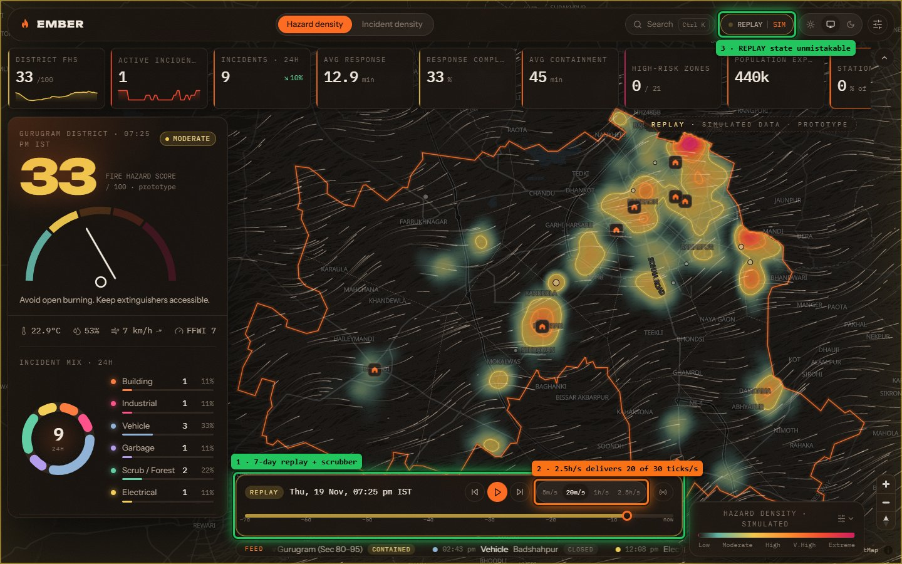
*Fig 08 — History replay at −16 h 40 m. ① Scrubber over 7 days with day marks. ② Top speed only reaches 67 % of the promised rate (M8). ③ REPLAY badge and gold frame make the mode impossible to miss.*

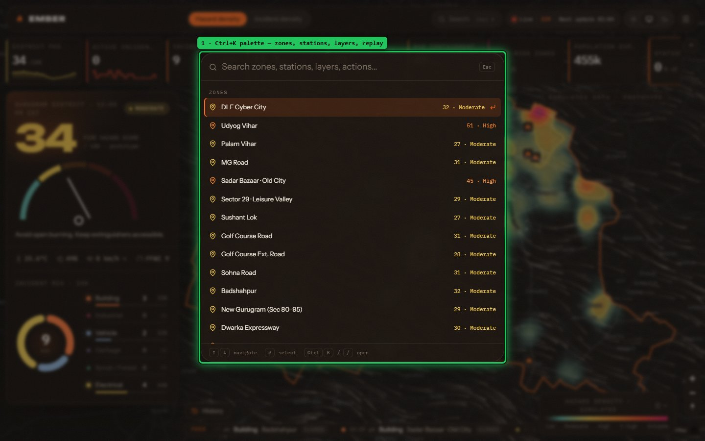
*Fig 09 — Command palette (Ctrl+K). Zones show live score and band. This capture is what found crash F1.*

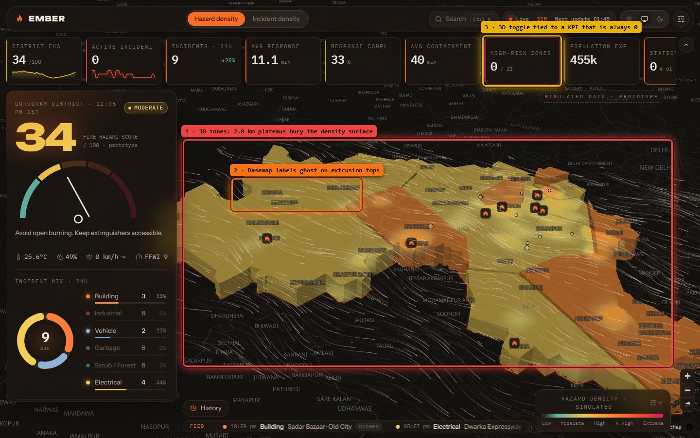
*Fig 10 — Terrain + 3D zones. ① About 2.8 km plateaus bury the density surface (C5). ② Basemap labels ghost on top (C5). ③ The 3D toggle is tied to a KPI that is always 0.*

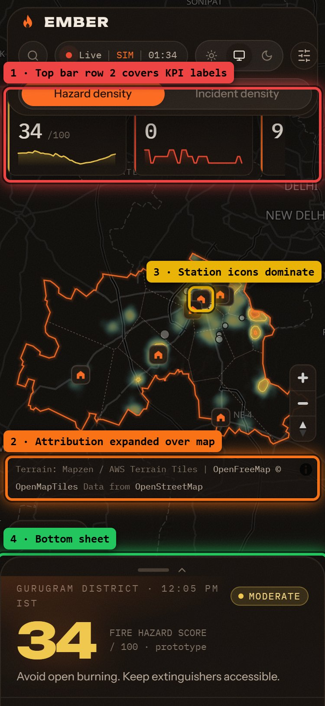
*Fig 11 — `/live` on a phone. ① Second top-bar row covers the KPI labels (C4). ② Attribution expanded over the map (M12). ③ Station icons dominate (m1). ④ Bottom sheet works.*

---

## Fix order (highest impact first)

1. **C1 recalibrate the model and C2 unify thresholds.** Until the numbers move, every other improvement is decoration. About 1 day, including a band-distribution test.
2. **C3 light-theme hazard colours and M5 small text / `--text-3`.** Token changes only. About 2 hours.
3. **C4 phone top bar and KPI strip, M3/M4 KPI overflow and labels.** About half a day.
4. **C5 3D mode rework.** Density columns instead of zone plateaus; hide labels when pitched. About half a day.
5. **M1, M2, M12, m3, m4** accessibility and hygiene. About 2 hours.
6. **M8, M9 performance.** Precompute the geometry and move the simulator to the worker. About 1 day.
7. **M10, M11 KPI honesty.** Sample sizes, fixed sparkline domains, replace dead KPIs. About half a day.

---

## Method and caveats

- **Capture:** `scripts/shoot.mjs` drives the installed Chrome headless through `playwright-core` (no browser download). Marks are injected as DOM overlays with automatic label placement. The spec is in `scripts/spec-audit.json`. Re-run with:
  ```bash
  node scripts/shoot.mjs scripts/spec-audit.json
  ```
- **Probes:** `scripts/audit-probe.mjs` computes token contrast from `tokens.css` (WCAG 2.1 relative luminance), fonts loaded, computed font sizes, unnamed controls, targets under 24 px, truncation, overflow, LCP, long tasks, rAF fps and console errors on 5 page/viewport/theme combinations. It also samples the KPIs at 9 replay offsets. Raw output is in `docs/audit/probe.txt`.
- **Caveats:**
  - Headless Chrome on this workstation is not a mid-range phone, so treat the fps and long-task numbers as relative, not absolute.
  - Each probe ran once.
  - Contrast is computed against solid tokens; the translucent glass panels sit on varying map pixels, so real contrast varies.
  - All data is simulated, so C1, C2 and M10 are findings about the **simulator and KPI definitions**, which carry straight over to production as the model.
  - The in-app browser pane throttles timers when it isn't in the foreground (playback looked like 1 tick/s there). That is not an app bug, and headless timing was used instead.

---

## Resolution log

Fixed one by one, re-measured with `scripts/audit-probe.mjs` (raw output in `probe-after.txt`) and re-captured with `scripts/spec-after.json`. Guard tests were added so the critical issues cannot quietly come back: **29 tests**, up from 15.

### Before → after (measured)

| Metric | Before | After |
|---|---|---|
| District FHS range, sampled 9× over 7 days | 28–34, "Moderate" 9/9 | **26–47**, Moderate ↔ High |
| Band share over a November week (Low/Mod/High/V.High/Ext) | ~0 / 100 / 0 / 0 / 0 % | **22 / 44 / 24 / 8.5 / 1.5 %** |
| Summer-peak scenario, Very High + Extreme | n/a | **24 %** (7.6 % Extreme) |
| Zones that are hottest at some point in the week | 1 | **10** |
| Density-peak zone across the week | Udyog Vihar 100 % | 6 zones (Udyog Vihar 70 %) |
| "0 high-risk" shown next to ">0 exposed" | yes | **impossible**: one threshold, enforced by a test |
| Light text tokens below 4.5:1 | 6 (amber score 2.87:1) | **0**, all ≥ 5.0:1 |
| Dark text tokens below 4.5:1 | 2 | **0** |
| Hazard/category fills below 3:1 | 2 | **0** |
| Text nodes under 11 px on `/live` | 31 (104 at 11 px or smaller) | **0** (minimum 11 px, labels 12 px) |
| KPI px hidden at 1440 px | 254 | **0** |
| Truncated KPI labels (desktop / phone) | 4 / 7 | **0 / 0** |
| KPI labels covered by the top bar on a phone | yes | **no** (offset measured live) |
| `h1` accessible name | "Everyember,mapped." | **"Every ember, mapped."** |
| Longest main-thread task on `/live` | 1347 ms | **232 ms** |
| `/live` LCP (desktop) | 1.4–3.4 s | **0.8–1.0 s** |
| Main JS bundle (gzip) | 143.5 KB | **124.0 KB** (turf removed from runtime) |
| Replay at "2.5h/s" (target 30 ticks/s) | 20.0 ticks/s | **30.1 ticks/s** |
| Console errors per load | 1 (favicon 404) | **0** |

### Finding-by-finding

| ID | Fix | Where | Evidence |
|---|---|---|---|
| **C1** | **Model recalibration.** The weather term is now 45 % FFWI percentile vs. this month's climatology + 30 % vs. the whole year + 25 % absolute. A per-land-use activity factor varies by time of day (markets in the evening, industry by day, landfill/scrub in afternoon heat, Oct–Nov stubble on the rural fringe). Each hotspot's density mass is normalised to its score, with per-hotspot jitter. Added a **summer-peak (May) scenario** for demos. | `sim/weather.ts`, `analysis/hazard.ts`, `data/SimulatedProvider.ts` | `tests/model.test.ts` (band shares, district range, peak variety, scenario); fig A1, A5, A12 |
| **C2** | One at-risk threshold (`AT_RISK_BAND` = High) for both "High+ zones" and "Pop. High+"; the threshold is printed on the tile ("FHS ≥ 40"). | `analysis/kpis.ts` | `tests/sim.test.ts` threshold-consistency test; fig A3 |
| **C3** | Split tokens: `--hz-*` stay vivid for fills; new `--hz-ink-*` (≥ 5:1) for all text. Light accent, ok/warn/bad and text-3 darkened. | `styles/tokens.css` + every text use | `tests/tokens.test.ts` (AA for all text tokens, 3:1 for fills, both themes); fig A2, A4, A6, A13 |
| **C4** | The top bar publishes its real bottom edge (`--topbar-bottom`, via ResizeObserver); the KPI strip, panels and watermark position from it. | `TopBar.tsx`, `KpiRow.tsx`, `app.css` | fig A10 |
| **C5** | Zone plateaus replaced by **1 km density columns** (max of 5×5 cells, height ∝ density, same colour scale as the surface). All basemap labels hidden while pitched. "3D zones" renamed to "3D density" and decoupled from the KPI. | `map/density.ts` (`columnsGeoJson`), `MapView.tsx` | fig A9 |
| **M1** | Real text spaces between the animated words. | `Landing.tsx` | probe `h1`; fig A1 |
| **M2** | Feed pause button (`aria-pressed`), pause on hover **and** keyboard focus; duplicate loop copy is `aria-hidden` and untabbable. | `IncidentTicker.tsx` | fig A5 ③ |
| **M3** | The KPI strip is a grid that fits 10 tiles at 1440 px; edge fades + chevron buttons appear only when it overflows. | `KpiRow.tsx`, `app.css` | probe `kpiHidden: 0`; fig A5 ① |
| **M4** | Short labels ("On-time", "Last 24h", "Pop. High+"); secondary info moved to its own meta line. | `KpiRow.tsx`, `StatTile.tsx` | probe: no truncated labels |
| **M5** | `--fs-xs` 11 → 12 px; every 9–10 px instance → 11 px; eyebrow tracking 0.16 → 0.10 em; `--text-3` ≥ 5:1. | tokens, CSS | probe `tinyTextNodes: 0` |
| **M6** | Light-theme ramp starts at amber (no translucent teal on cream); the legend uses the same per-theme `--ramp` token. | `density.ts` (`buildLut`), tokens | fig A6 ③ |
| **M7** | Hero map hides basemap labels; stronger scrim on the text side (desktop and phone). | `MapView.tsx`, `landing.css` | fig A2, A11 |
| **M8** | Replay steps the 24 h history by one point instead of recomputing 288; the 24 h-ago count is cached; KDE is throttled to about 7/s during playback (latest tick wins). | `store.ts` (`load`), `MapView.tsx` | 30.1 ticks/s measured; fig A8 |
| **M9** | Voronoi clipping is precomputed at build time (`npm run gen:geo` → `zones.generated.json`); turf replaced at runtime by a cached-bbox point-in-polygon. | `scripts/gen-geo.ts`, `geo/zones.ts`, `sim/geoutil.ts` | long task 1347 → 232 ms; −19.5 KB gz |
| **M10** | Response, on-time and containment use a **rolling 72 h window with n shown** ("n=23 · 72h"). The dead "Station utilization" tile is replaced by **"Next peak"** (24 h weather-driven outlook: time + FHS + band); units out stay in the station popup and zone drawer. | `kpis.ts`, `SimulatedProvider` (`getForecast`, `getIncidentsWindow`) | fig A3 |
| **M11** | New `BandTrend`: fixed 0–100 axis, band stripes, y/x labels, dashed 24 h outlook. FHS sparklines in tiles use a fixed 0–100 domain. | `ui/BandTrend.tsx`, `StatTile.tsx` | fig A3, A7 |
| **M12** | Compact attribution starts collapsed on every viewport. | `MapView.tsx` | fig A10 ② |
| m1 | Stations drawn in neutral ink, no longer hazard-orange. | `app.css` | fig A6 ④ |
| m2 | Legend title shortened to one line ("Hazard density"); the SIM label lives in the watermark and badge. | `DensityControls.tsx` | fig A5 ④ |
| m3 | Feed items 32 px, nav links 36 px, wordmark 32 px, phone sheet handle 32 px. | CSS | probe: only the off-screen skip link is under 24 px |
| m4 | SVG favicon added. | `public/favicon.svg` | 0 console errors |
| m5 | Unused Unbounded 400/500 no longer requested (7 → 5 font files). | `index.html` | `document.fonts` |
| m6 | `?tick=` is clamped to ≤ 0: no future data under a LIVE badge. | `store.ts` (`initialOffset`) | code |
| m7 | A paused replay keeps its absolute time across real tick boundaries (`tickBoundary`). | `store.ts`, `useLiveData.ts` | code |
| m8 | The station card says "straight-line" and gives an estimated minutes figure. | `ZoneDetail.tsx` | fig A7 ③ |
| m9 | Real `h2`/`h3` headings for the KPIs, district panel, sections and feed (styled as eyebrows). | panels | probe headings H1 H2 H2 H3 H3 H2 |
| m10 | "Peak density" uses a text-value tile style plus a meta line. | `StatTile` (`textValue`) | fig A5 |
| m11 | Hero map padded so the hot area sits left of the card. | `Landing.tsx` | fig A1 ③ |
| m12 | Wind disclosed as "one district-wide simulated vector, illustrative only" in the density controls, palette and weather tooltip. | `DensityControls.tsx`, `CommandPalette.tsx`, `DistrictPanel.tsx` | code |
| (new) | **Bug I introduced while fixing C3 and caught in re-audit:** the explicit dark-theme block was missing the ink tokens. Fixed, and `tests/tokens.test.ts` now asserts both dark blocks are identical. | tokens | test |


### Reported by the user during the fix pass

| ID | Issue | Cause | Fix | Evidence |
|---|---|---|---|---|
| **N1** | **Gauge needle "breaks"** (detached from the hub at high values, e.g. 72) | Motion's `rotate` on an SVG `<line>` uses the line's own bounding-box centre as the origin, not the hub. Values near 50 hide it; ±40° exposes it. | Needle drawn in a `<g transform="rotate(angle cx cy)">` (explicit SVG pivot), with a spring-animated angle. | `tests/gauge.test.ts`; visually verified at 21 and 87 |
| **N2** | **Site lags with terrain on** | (a) Wind particles call `map.project()` about 1,500×/frame, which samples terrain elevation in 3D; (b) `setTerrain` was re-applied on every layer toggle; (c) the 3D mesh used the full-res DEM (z13) out to the horizon at 58° pitch. | Wind pauses in 3D (its chip shows "paused" with a tooltip; 2D streaks were wrong in 3D anyway); terrain set only when it changes; dedicated z11 DEM for the mesh (hillshade keeps z13); exaggeration 4→3; max pitch 70→60, 3D view pitch 58→50. | `scripts/spec-perf.json`: camera move with terrain + 3D went from **44.5 fps / p95 36.6 ms / worst 55.6 ms** to **59.3 fps / p95 24.7 ms / worst 45.7 ms** (flat map: 60 fps / 17 ms) |

### After figures

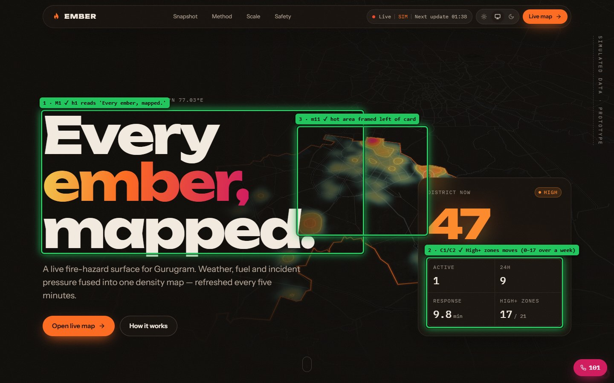
*A1 — Landing hero, dark: correct `h1` text; the hero card's High+ count now moves; the hot area is framed beside the card.*

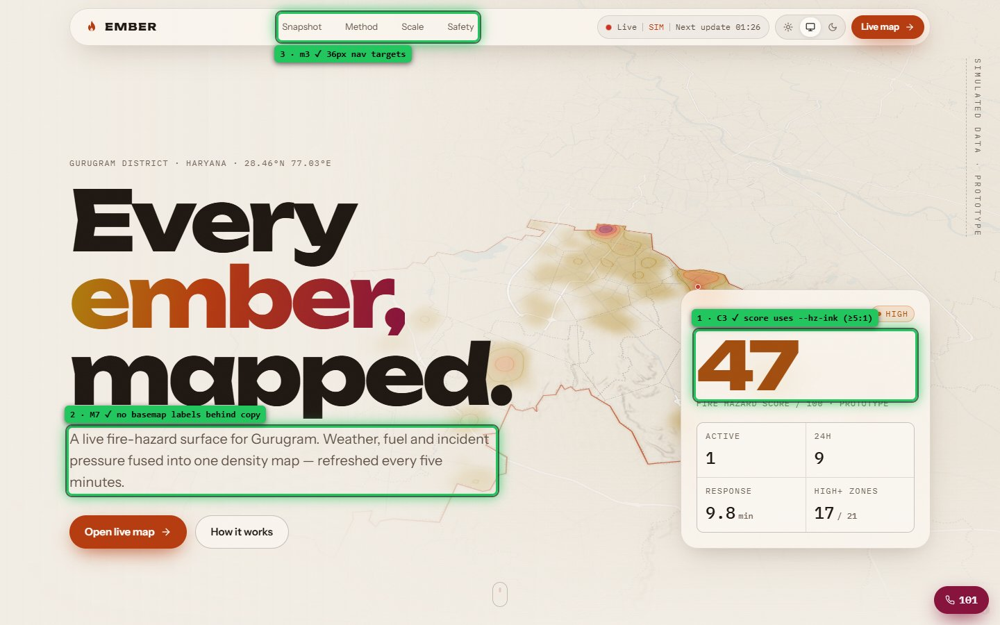
*A2 — Landing hero, light: the score is in the ink colour (≥ 5:1); no basemap labels behind the copy; 36 px nav targets.*

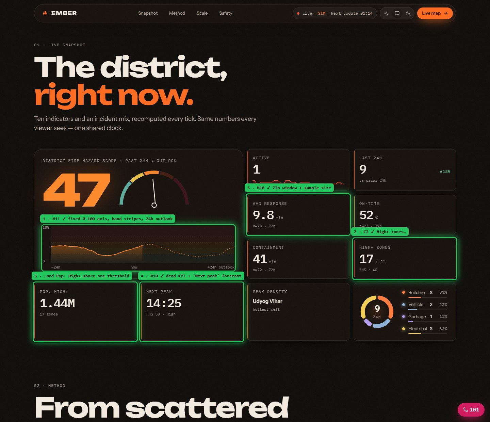
*A3 — Snapshot: honest 0–100 trend with 24 h outlook; High+ zones and Pop. High+ agree; "Next peak" replaces the dead KPI; response KPIs show n and window.*

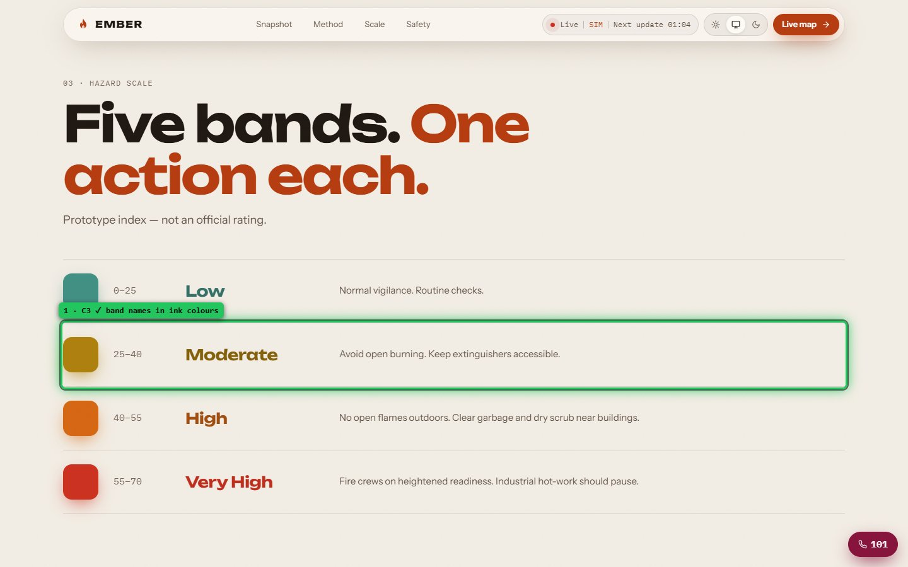
*A4 — Scale, light: band names in AA ink colours.*

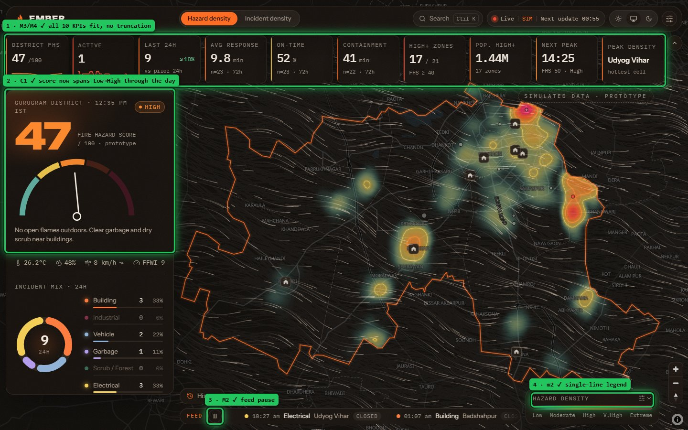
*A5 — `/live`, dark: all 10 KPIs fit without truncation; the score moves through the day; feed pause; one-line legend.*

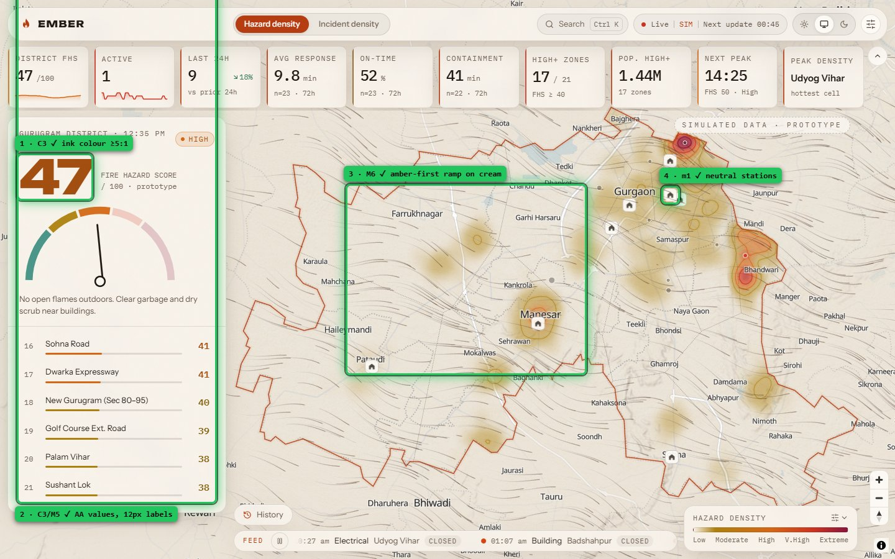
*A6 — `/live`, light: ink-coloured numbers, 12 px labels, amber-first density on cream, neutral station markers.*

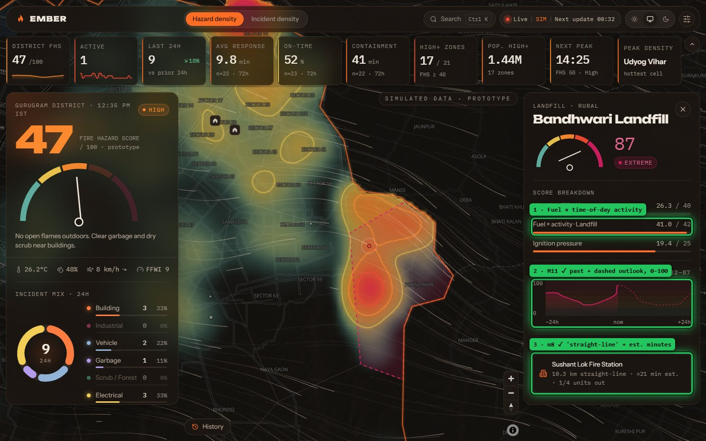
*A7 — Zone drawer: fuel × time-of-day activity, trend with dashed outlook on a 0–100 axis, honest straight-line ETA.*

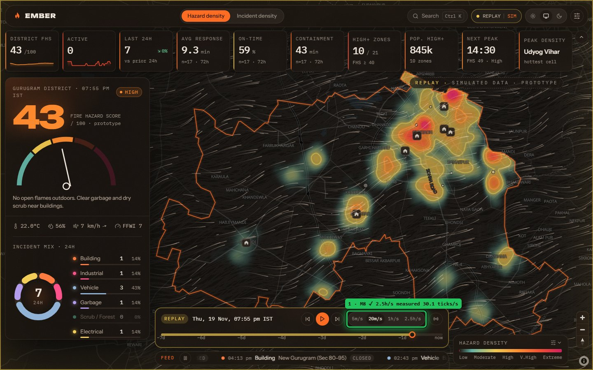
*A8 — Replay: 2.5h/s now delivers 30.1 ticks/s.*

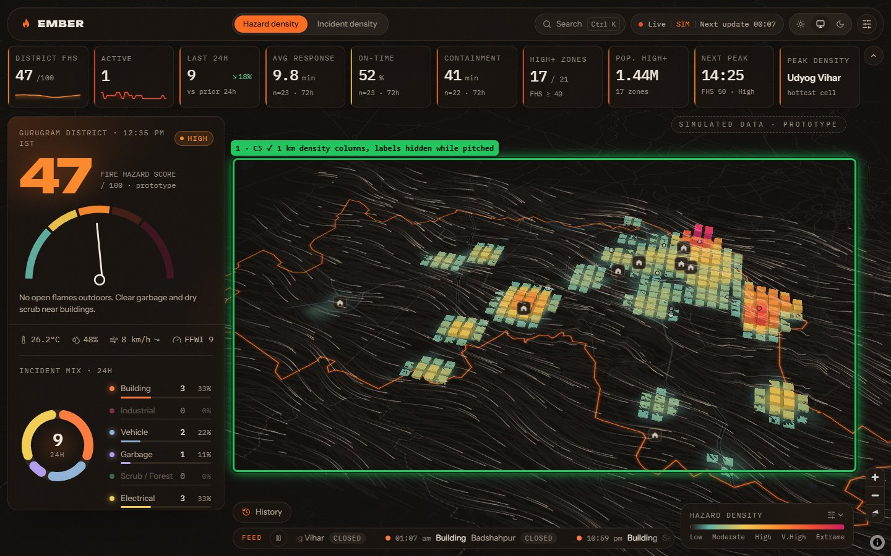
*A9 — 3D density + terrain: 1 km columns rise from the surface; labels hidden while pitched; the surface is no longer buried.*

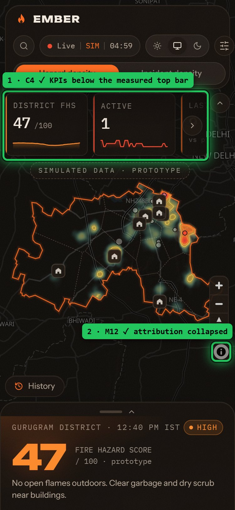
*A10 — Phone: KPIs sit below the measured top bar; attribution collapsed.*

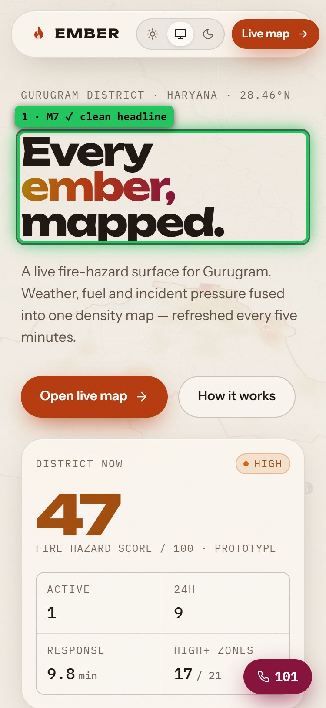
*A11 — Phone landing: clean headline, no label collisions.*

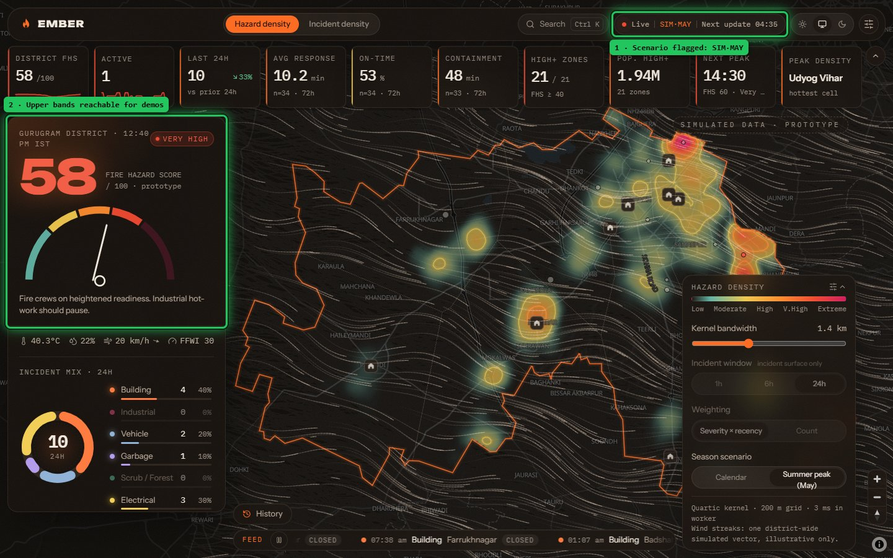
*A12 — Summer-peak scenario: flagged as SIM·MAY in the badge; upper bands reachable for demos.*

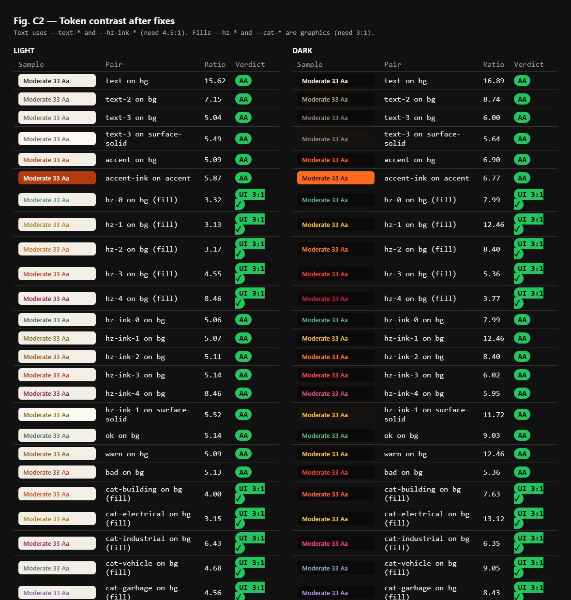
*A13 — Contrast after fixes: every text token ≥ 4.5:1, every fill ≥ 3:1, both themes.*

### Remaining caveats (honest)

- **Udyog Vihar is still the density peak 70 % of the time.** That is plausible (the largest industrial cluster, next to other hot zones), but it is a modelling choice, not data.
- **Phone KPI strip still scrolls horizontally** (1071 px of content), now with fades and chevrons. A phone-specific 3-KPI layout would be better.
- **Fills vs ink:** hazard colours used as map or chart fills meet only the 3:1 graphics threshold in light mode, which is correct for graphics but means they must never be used for text. The token test enforces the ink set, not usage.
- The forecast is the same simulator run forward (weather only, no new incidents), not a real forecast. A production provider must supply one.
- Headless timings come from one workstation and one run each. Terrain on a low-end laptop GPU will still cost more than the flat map; the remaining worst frames (about 46 ms) are DEM tile decodes while new terrain streams in.

---

## Round 3: responsive layout, phone KPIs, terrain loading

Requested after the fix pass: 3 KPIs on phones, a fix for the layers popover overlapping the KPIs, a fix for the gap under the left panel, terrain limited to India and loaded lazily, and optimisation for every screen class.

| Issue | Fix | Verified |
|---|---|---|
| Layers popover overlapped the KPI strip (translucent glass, tiles bled through) | Opaque surface, z-index above the strip, closes on outside tap or `Esc` | fig D3 |
| Dead strip under the left panel | Side panels now run to the bottom gutter; the history/feed bar sits in the column between them | figs D3, D4 |
| **Incident feed vanished** on phones/tablets and whenever a zone was open (regression from wrapping history + feed) | Removed two stale `.live-bottom .glass:last-child { display:none }` rules | device sweep |
| KPI labels truncated at about 1530 px | KPIs are tiered 1–5 and the strip shows only what fits: **3** (phone) → **4** (tablet portrait / landscape phone) → **6** (tablet landscape) → **8** (laptop) → **10** (≥1600 px). Hidden ones appear in **"More indicators"** in the district panel, so nothing is lost. Phones get short labels (FHS, Active, High+). | 0 truncations on 14 devices |
| Not tuned for phones/tablets | New `responsive.css` owns all `/live` geometry: 5 breakpoints, iOS/Android **safe-area insets** (`viewport-fit=cover`), `100dvh`, landscape-phone layout (single-row top bar, no sparklines), tablet-portrait floating card, 40 px touch targets on coarse pointers, zoom buttons hidden on touch phones (pinch instead), map padding recomputed on rotate/resize | device sweep below |
| Terrain loaded worldwide | Both elevation sources have `bounds` = India; hillshade has `minzoom: 6` | **0** tiles outside India, **0** below z6 |
| Terrain loaded up front | Relief is added only once the first view has fully painted **and** the browser is idle, and after the globe intro. The landing hero has no relief at all. The 3D mesh still loads only when Terrain is switched on (or instantly on demand if the user toggles before idle). | Landing **52 → 0** tiles; intro **115 → 24**, starting after the fly-in |

**Device sweep** (`scripts/spec-devices.json`; it measures overlaps between the main UI blocks, horizontal overflow, truncated labels and visible KPI count):

| Device | Viewport | KPIs in strip | Overlaps | Overflow | Truncated |
|---|---|---|---|---|---|
| iPhone SE | 320×568 | 3 | 0 | 0 | 0 |
| Android small | 360×780 | 3 | 0 | 0 | 0 |
| iPhone 13 mini | 375×812 | 3 | 0 | 0 | 0 |
| iPhone 15 | 393×852 | 3 | 0 | 0 | 0 |
| Pixel 8 | 412×915 | 3 | 0 | 0 | 0 |
| iPhone Pro Max | 430×932 | 3 | 0 | 0 | 0 |
| Phone landscape | 844×390 | 4 | 0 | 0 | 0 |
| iPad mini | 768×1024 | 4 | 0 | 0 | 0 |
| iPad Pro 11" portrait | 834×1194 | 4 | 0 | 0 | 0 |
| iPad landscape | 1024×768 | 6 | 0 | 0 | 0 |
| Laptop | 1280×800 | 8 | 0 | 0 | 0 |
| 1920 @125% (your screen) | 1536×864 | 8 | 0 | 0 | 0 |
| Full HD | 1920×1080 | 10 | 0 | 0 | 0 |
| QHD | 2560×1440 | 10 | 0 | 0 | 0 |

The landing page has 0 overflow on all six sizes tested.

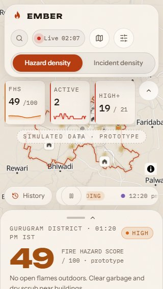
*D1 — iPhone SE (320 px): 3 KPIs with short labels; history + feed on one row; sheet peek.*

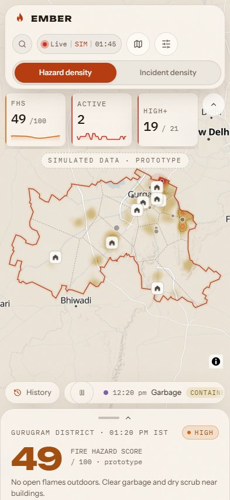
*D2 — iPhone 15.*

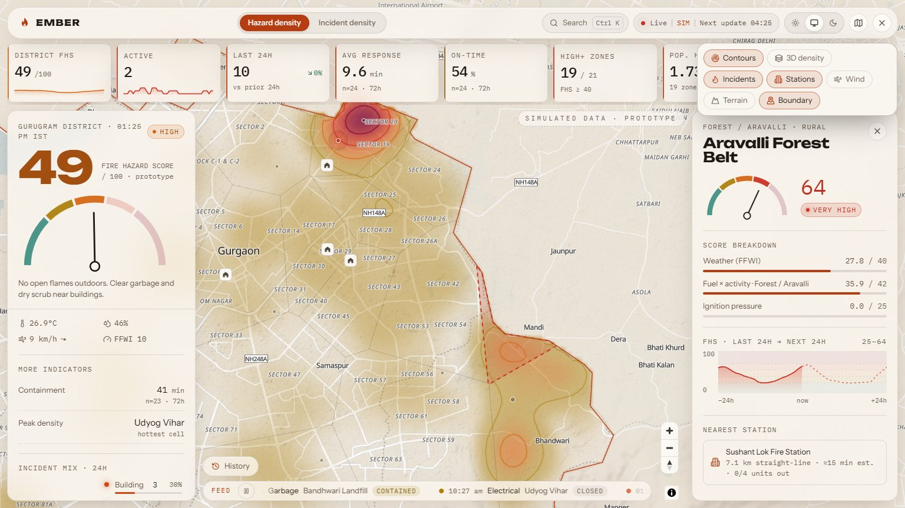
*D3 — 1536×864 with the zone drawer and layers popover open: popover is opaque; 8 KPIs fit; panels reach the bottom; feed visible between the panels.*

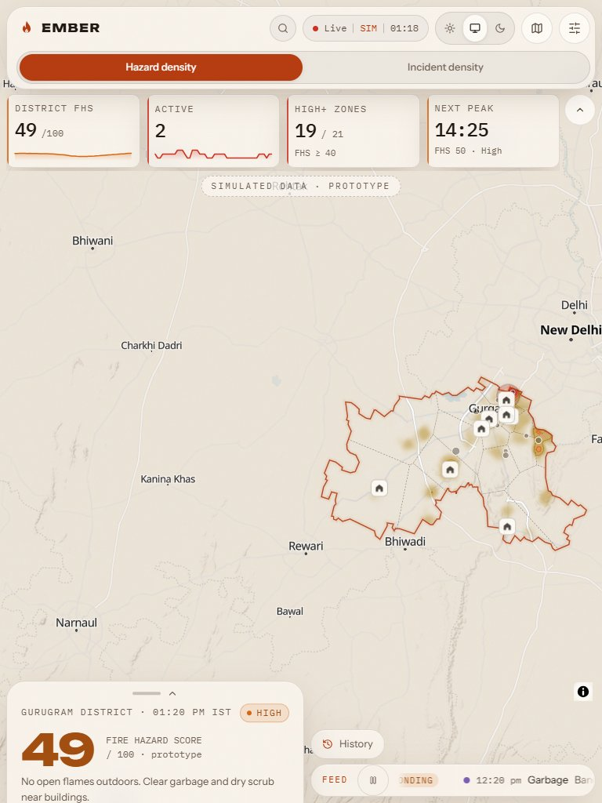
*D4 — iPad mini portrait: 4 KPIs, floating district card, map stays visible.*

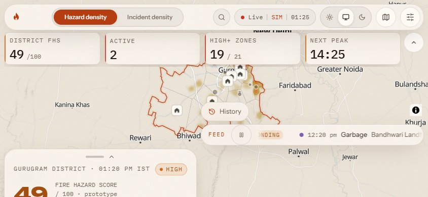
*D5 — Landscape phone: single-row top bar, compact tiles.*

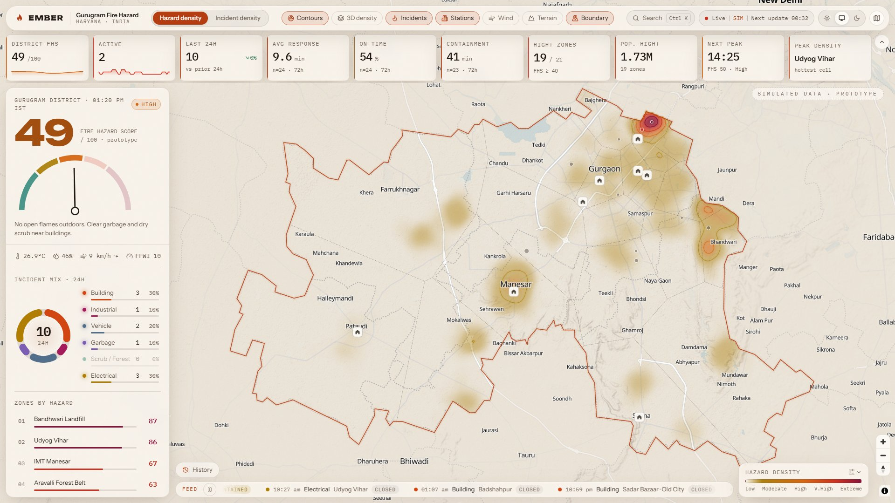
*D6 — Full HD: all 10 KPIs.*

**Terrain performance** (camera move, terrain + 3D on, tiles settled): 54.5–56.7 fps, p95 ≈ 26 ms (two runs). Right after switching Terrain on, frames are slower for a few seconds while the India-only tiles stream in. That is the trade-off for not loading them up front.
